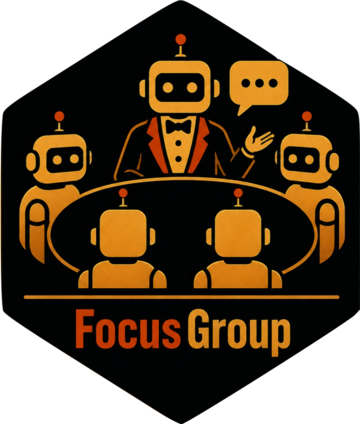

# FocusGroup: simulated moderated discussion for research design



[](https://github.com/asanaei/FocusGroup/actions/workflows/R-CMD-check.yaml)
[](https://asanaei.github.io/FocusGroup/)
[](https://lifecycle.r-lib.org/articles/stages.html#experimental)

## What FocusGroup is for

FocusGroup runs moderated discussions in which language models act as the
moderator and participants. A moderator guide sets the sequence of the
discussion, and a turn-taking rule selects each participant speaker. Model
requests use [LLMR](https://asanaei.github.io/LLMR/).

The package supports moderator-guide piloting, comparison of discussion
protocols, and studies of interaction under specified personas, histories, and
speaker-selection rules. These uses concern research design. A generated
transcript records model responses under the chosen guide, persona set, model
configuration, and turn-taking rule. It does not estimate public opinion.

FocusGroup is experimental. Its interface may change before a stable release.

To work without writing code, `run_focus_studio()` opens a point-and-click
interface that runs a session, analyzes a transcript, and compares
continuations. It has an offline demonstration mode, so it can be explored
without a provider key. See "Use Focus Studio" below.

## Install and configure a model

```r
install.packages("LLMR")
remotes::install_github("asanaei/FocusGroup")
```

API operations that generate model output require an explicit `config`. Under
the hood, FocusGroup calls language models through the LLMR package, which reads
your API key from an environment variable such as `OPENAI_API_KEY`. Set it once
in your `~/.Renviron` file, a plain text file in your home directory.

```r
library(FocusGroup)
library(LLMR)

config <- LLMR::llm_config(
  provider = "openai",
  model = "gpt-4o-mini",
  temperature = 0.7,
  max_tokens = 200
)
```

## Run a moderated session

`run_focus_group()` builds the moderator, participants, guide, and turn-taking
rule, then runs one session.

```r
moderator_guide <- list(
  Opening = "Welcome the group and state the ground rules.",
  Icebreaker = c(
    "What first comes to mind when you think about remote work?",
    "What experience has shaped that impression?"
  ),
  Engagement = "Where does remote work enter your daily routine?",
  Exploration = c(
    "What tensions arise between flexibility and coordination?",
    "Whose perspective has received too little attention?"
  ),
  Closing = "Thank the participants and close the session."
)

result <- run_focus_group(
  topic = "The impact of remote work on team collaboration",
  n_participants = 4,
  guide = moderator_guide,
  flow = "round_robin",
  config = config,
  seed = 110,
  message_mode = "roleflip",
  verbose = TRUE
)

print(result)
head(result$transcript, 5)
result$participants
result$usage
cat(result$summary)
```

The result contains the underlying `focus_group`, a row-oriented `transcript`,
the final `summary`, a `participants` data frame, token `usage`, and study
`metadata`.

## Design the moderator guide

The `guide` argument accepts either phase counts or ordered moderator
instructions. A named numeric vector selects that many built-in instructions
for each phase:

```r
count_guide <- c(
  Opening = 1,
  Icebreaker = 1,
  Engagement = 2,
  Exploration = 3,
  Closing = 1
)
```

A named list, such as `moderator_guide` above, supplies the instruction text.
A character vector within one phase supplies several moderator turns in order.
The supported phases are Opening, Icebreaker, Engagement, Exploration, and
Closing. A guide may omit phases, but phases that are present must follow this
order and each may appear once. Opening and Closing contain moderator turns;
Icebreaker, Engagement, and Exploration also collect participant responses.

## Choose a turn-taking rule

The `flow` argument controls how a participant is selected after a moderator
question. The choice changes both the study design and the number of model
calls.

| Mode | Speaker selection | Research use and cost |
|---|---|---|
| `"round_robin"` | It cycles through participant IDs in a fixed order, passing over a participant who has just spoken in a turn the moderator gave. | Use it when equal speaking opportunity and predictable exposure are design requirements. It adds no speaker-selection model calls. |
| `"probabilistic"` | It samples from speaking propensities. The selected participant's propensity falls to zero, while the other propensities recover toward their baselines by `recovery_increment`, which defaults to `0.1`. | Use it when unequal, stochastic participation is part of the design but speaker choice should not depend on model-rated content. |
| `"desire_based"` | It asks eligible personas to rate their desire to speak from the current question and transcript. It passes over the participant who spoke just before, unless the moderator has spoken since, uses `min_desire_threshold = 3`, may relax the threshold after discussion begins, selects the highest score, and breaks ties at random. A score that cannot be obtained stops the session, unless `on_desire_failure = "random"`, which chooses among the valid scores. | Use it when content-responsive speaker emergence is the object of study. It adds model calls and makes speaker assignment model-dependent. |

`"desire_based"` is the default. Nondefault propensity, recovery, or desire
settings require `create_conversation_flow()` and direct construction, described
in the advanced section below.

Two kinds of turn bypass the flow. First, the moderator calls on participants
who have not spoken. At the first, middle, and last questions participants
answer (`call_on_silent = c("opening", "midpoint", "end")`, items 2, 4, and 7
of the default guide), once the discussion of the question ends, the moderator
turns to each participant who has said nothing since the previous such point
and asks, in a fixed line, "P4, I'd like to hear from you as well. What are
your thoughts?" The line is delivered as written, with no model call, and the
participant answers without a desire score. The first point gives every
participant a turn during the first question, as the round-robin opening
question of Krueger (2002) does. Item numbers place the points elsewhere,
`call_on_text` supplies other wording, and `call_on_silent = "none"` turns
call-ons off. Second, when the moderator's line puts its last question to one
participant by name, as in "Could you say more, P3?", that participant answers
next. The routing record marks these turns `"called_on"` and `"addressed"` and
names the moderator line that gave the floor.

Krueger, R. A. (2002). *Designing and Conducting Focus Group Interviews*.
University of Minnesota.

## Build participants from personas and respondent data

Participant records can enter as direct descriptions, in-memory respondent
rows, a pre-rendered persona panel, or a labeled survey file. Each constructor
returns a named list of `FGAgent` objects containing the participants and a
moderator.

Use direct descriptions when the persona text has already been specified:

```r
direct_agents <- create_agents(
  n_participants = 2,
  direct_persona_descriptions = c(
    "A union representative who works on site five days a week.",
    "A software developer who works from home and coordinates across time zones."
  ),
  config = config
)
```

`create_agents_from_data()` accepts respondent rows already in memory.
Demographic columns are rendered as background and the remaining columns as
survey responses. Values are used as supplied, so coded values should be
decoded before this call.

```r
respondents <- data.frame(
  age = c(34, 61),
  occupation = c("accountant", "school administrator"),
  `How often do you work remotely?` = c("three days a week", "never"),
  check.names = FALSE
)

record_agents <- create_agents_from_data(
  respondents,
  n_participants = 2,
  demographic_cols = c("age", "occupation"),
  config = config
)
```

A data frame with `persona` and `persona_id` columns is treated as a
pre-rendered persona panel. This includes `LLMR::anes_2024_personas`:

```r
data(anes_2024_personas, package = "LLMR")

panel_agents <- create_agents_from_data(
  anes_2024_personas,
  n_participants = 6,
  config = config
)
```

`create_agents_from_survey()` reads Stata, SPSS, and SAS files through `haven`.
It renders each answer from the file's value labels. A number the file leaves
unlabeled is shown on its scale when the item labels only the endpoints ("On a
scale of 1 to 7, where 1 is ... and 7 is ..., you place yourself at 5"), and
as a number in a numeric field such as age; `scale_template` rewords that
sentence, for instance for a placement of a candidate rather than oneself.
Questions are shown in the wording given in `question_wording`, else under the
variable labels, with a warning. `value_labels` replaces labels the file cut
short and labels stray codes. Labels that mark an answer as missing, matched
by `fg_default_na_strings()`, are left out.

```r
survey_agents <- create_agents_from_survey(
  n_participants = 6,
  survey_path = "respondents.dta",
  config = config,
  demographic_vars = c(age = "AGE", education = "EDUC"),
  survey_vars = c("Q12", "Q13"),
  question_wording = c(Q12 = "Would you prefer to work from home?",
                       Q13 = "How long is your commute?")
)
persona_rendering_report(survey_agents)
```

`persona_rendering_report()` lists, for each participant, every requested field
and item with the text its persona shows, or the reason it was left out.
Answers shown in a form that needs checking, such as a code without a label,
are marked and named in a warning.

When direct persona text is absent, the constructors render the supplied
demographic fields and survey responses. They do not infer dispositions from
demographic labels. `run_focus_group()` accepts in-memory demographics and
survey responses through its own arguments. Rosters returned by the
constructors above are used with direct `FocusGroup` construction.

## Import and analyze transcripts

`focus_group_from_transcript()` imports a simulated or observed transcript for
analysis. Importing and descriptive analysis make no model call. Pass
`moderator_id` when the moderator is known. If it is omitted, the importer
treats a speaker named exactly `mod`, `moderator`, `facilitator`, or
`interviewer` (in any case) as the moderator; an identifier such as
`"Moderator 1"` needs `moderator_id`. A transcript saved from a session, such
as `result$transcript` written to a CSV file, keeps its message ids, rounds,
phases, and token counts when it is imported again.

```r
transcript <- data.frame(
  speaker = c("Facilitator", "P1", "P2"),
  text = c("What should change?", "Service frequency.", "Lower fares.")
)

imported <- focus_group_from_transcript(
  transcript,
  topic = "Public transit",
  moderator_id = "Facilitator"
)

offline_analysis <- analyze_focus_group(imported, include_plots = FALSE)
```

`analyze_focus_group()` returns `basic_stats`, `topics`, `tfidf`,
`readability`, `themes`, `model_summary`, `plots`, and `issues`. Components that
cannot be computed are returned as empty components with consistent columns
where they are tabular. `plots` is an empty list when `ggplot2` is unavailable,
and `issues` records each optional analysis that failed and its reason.

Descriptive analyses run offline. Thematic analysis and model summaries are
opt-in and run only when the caller supplies `config`:

```r
model_analysis <- analyze_focus_group(result, config = config)
```

A requested model analysis raises a provider condition if the provider call
fails. It does not convert that failure into a missing component. Additional
text analyses and plots use optional packages:

```r
install.packages(c(
  "ggplot2", "quanteda", "quanteda.textstats", "topicmodels", "tidytext"
))
```

FocusGroup does not export specialized report constructors. `LLMR::report()`
is the ecosystem reporting entry point.

## Summarize a discussion

`summarize_focus_group()` asks a model to summarize a session, a set of arms,
or an imported transcript by participant, guide item, disagreement,
trajectory, turn, or the whole session. The lengths `"headline"`, `"brief"`,
and `"detailed"` that you request come back from one call per unit, so they
agree with each other.

```r
summaries <- summarize_focus_group(
  result, config,
  by = "participant",
  compression = c("headline", "brief")
)
summaries$summaries  # one row per unit and length
summaries$claims     # each claim kept, with its status and evidence
summaries$quotes     # each quote, cut from the message it cites
```

The model returns claims as JSON, not prose. Each claim has a status
(`"stated"`, `"implied"`, `"contradictory"`, or `"not_stated"`), the messages
it rests on, and any words it quotes, and each is checked in code before
prose is rendered from it. A cited message must exist and lie within the
unit, and its speaker must be the one the claim names. A quote must appear in
the cited message, allowing only for differences of case, whitespace, and
quotation marks. A claim for the whole group must cite every participant who
spoke on the item, and a silent participant can only be reported as silent.
A reply that fails is sent back once with each failure stated. A second
failure stops with an error of class `focusgroup_summary_check_failure` that
carries the units already completed; `on_fail = "drop"` sets the failing
claims aside instead, unless they report a disagreement, a position held
alone, or a change.

The summarizing model sees handles, never user IDs: the speakers of an
imported transcript reach it as P1, P2, and so on, in the speaker labels and
inside the messages. It never sees personas or
the System row, and it sees private probe answers only with
`include_probes = TRUE`. Calls are recorded in the summary's `calls` table,
apart from the session's records, and an estimate above `max_calls` stops the
run before any call unless `confirm = TRUE`. `fg_turns()` returns the turn
table the summaries read, with no model call.

## Replay a session in the browser

`fg_player()` writes a finished session to one HTML file that replays it
step by step, for showing a session in a talk or checking a run by eye. The
page opens with the design of the session and each participant's persona as
sent, then shows the messages in order. Under desire-based selection, a
panel before each turn gives the desire score of every participant asked and
names the one who took the floor, and under probabilistic selection it gives
each participant's chance in the draw. A turn that the moderator gave by
calling on or addressing a participant is marked as such, private answers
appear where they were asked, and injected comments carry their source. The
page is built from the session's records and calls no model. Its styles,
script, and data are inline, so it opens from disk without a network
connection.

```r
fg_player(result)
fg_player(result, file = "session.html", mode = "static", open = FALSE)
```

The right arrow, the space bar, or a presentation clicker moves forward and
the left arrow moves back; S shows or hides the selection panels, and F
fills the screen. `mode = "static"` shows every step at once, for printing
and archives. For the result of `run_focus_group_arms()`, the function writes
one file per arm, each holding the shared messages and that arm's
continuation. The package includes a synthetic session, made with a scripted
runner, on which the page can be tried without a provider key:

```r
session <- readRDS(system.file("extdata", "player-session.rds",
                               package = "FocusGroup"))
fg_player(session)
```


## Use Focus Studio

`run_focus_studio()` starts the optional Shiny interface. Its Run tab starts
sessions with participants drawn from the bundled ANES 2024 records, rendered
from their demographic fields alone or from respondent fields you select. The
first kind of session uses `run_focus_group()`; the second uses
respondent-derived agents with the same guide, flow, and session classes. The Analyze tab reads participation and word
statistics offline. The Continuation experiment fixes the next participant
speaker and generates one next message under the original history and one under
a history with an earlier message edited. These paired continuations support a
comparison of the specified next turn; they do not continue the full session.

Session execution and continuation generation make live model calls. Install
the suggested `shiny`, `bslib`, `DT`, and `LLMR.shiny` (version 0.1.3 or later)
packages before starting the interface.

## Study records, cost, and interpretation

The transcript records each message with its phase, round, and guide item. A
generated row also carries what the provider returned about the call, such as
its response identifier, finish reason, and token counts, together with the
provider and model that produced it. Moderator questions and their participant
responses share a round.

The agents see each other as `P1`, `P2`, ... in roster order and the moderator
as `Moderator`, whatever IDs the roster uses. The transcript keeps the IDs in
`speaker_id` and the labels the agents saw in `handle`, so agents built
directly with IDs such as `"teacher_conservative"` or `"V240001"` never see
those IDs in a prompt. `handles = "ids"` shows the IDs instead, and a vector
such as `c(teacher_conservative = "Ana")` sets labels of your own. Identifier
columns (`id`, `respondent_id`, `persona_id`) are kept in the roster's
`source_ids` and are not rendered into personas.

The `participants` component is a data frame. `usage` uses LLMR's `sent`, `rec`,
and `total` token vocabulary, and `unknown` counts the calls whose usage was
incomplete. A count a provider did not report is unknown rather than zero: it
is `NA` on the transcript row, and when `unknown` is positive the totals in
`usage` are lower bounds. `unknown` is `NA` when the number cannot be
determined, as in a partial result whose last call raised an error. `metadata` records `topic`, `purpose`,
`flow`, `message_mode`, `n_participants`, `estimated_calls`, `provider`, and
`model`, followed by `complete` and `failure`, which say whether the session
finished and, if not, in which phase it stopped. Credentials are never
included.

If a model call fails partway through a session, `run_focus_group()` raises an
error of class `focusgroup_incomplete_session`. The error's `partial` field
holds the result for the turns completed before the failure:

```r
result <- tryCatch(
  run_focus_group("Public transit", config = config),
  focusgroup_incomplete_session = function(e) e$partial
)
result$metadata$failure
```

Before a live run, `run_focus_group()` estimates the number of model outputs
the session will generate. A run whose estimate exceeds `max_calls` stops
unless `confirm = TRUE`. The default session of six participants plans at most
111 outputs, inside the default `max_calls` of 120: 93 for the moderator's
lines, the replies to them, their desire scores, and the final summary, and 18
for replies to call-ons, one per participant at each of the three points. The
realized number of calls can be lower, since the desire-based flow does not
score the previous speaker, addressed and called-on turns need no scores, and
only silent participants are called on, or higher, since incomplete replies are
retried and long discussions are summarized. `final_summary = FALSE` saves the
summary call.

A generated transcript is evidence about the specified simulation, not a
population. Interpretation should retain the moderator guide, participant
records, model configuration, turn-taking rule, and message construction with
the study record.

## Advanced construction, testing, and extension

Direct construction creates an agent roster, builds a flow with
`create_conversation_flow()`, passes both to `FocusGroup$new()`, and calls
`run_simulation()`. A `FocusGroup` object represents one session and runs once.
`FGAgent$new()` also takes `config`, stored in its public field of the same name.
Built-in rules are created through `create_conversation_flow()`.
`ConversationFlow` is the base class for custom turn-taking rules.

The `.runner` argument accepts an optional function for offline tests or replay
instead of live model calls. It uses the same request and response data-frame
format as LLMRcontent archive replay: the function receives a data frame with
`config` and `messages` list-columns and returns those rows with at least
`response_text`. It handles moderator, participant, desire-scoring, and summary
requests. An explicit configuration remains required and is recorded with the
experiment so readers can see how it was run. Supplying `.runner` bypasses the
live cost stop.

`get_default_prompt_templates()` returns the supported participant, moderator,
desire-scoring, and thematic-analysis templates. Named replacements can be
passed as `prompt_templates` to `FocusGroup$new()`. See `?run_focus_group`,
`?FocusGroup`, `?FGAgent`, and `?ConversationFlow` for the direct API and return
values.

## Related packages

FocusGroup uses [LLMR](https://asanaei.github.io/LLMR/), the common provider
interface on CRAN. [LLMRcontent](https://asanaei.github.io/LLMRcontent/) codes
text with codebooks and builds replication archives.
[LLMRpanel](https://asanaei.github.io/LLMRpanel/) administers survey and
experimental instruments to panels of model personas.
[LLMRagent](https://asanaei.github.io/LLMRagent/) provides tools for agent
experiments. The [ecosystem page](https://asanaei.github.io/LLMR-ecosystem/)
describes the package boundaries.

## Contributing

Report bugs and feature requests in the
[GitHub repository](https://github.com/asanaei/FocusGroup). Pull requests may
be submitted there.

## License

This project uses the MIT License; see `LICENSE`.
